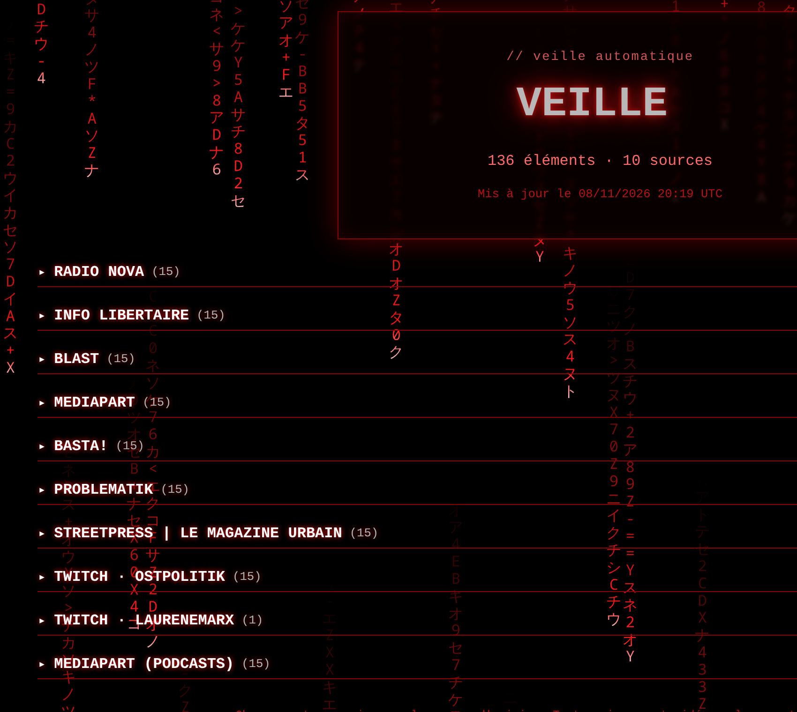
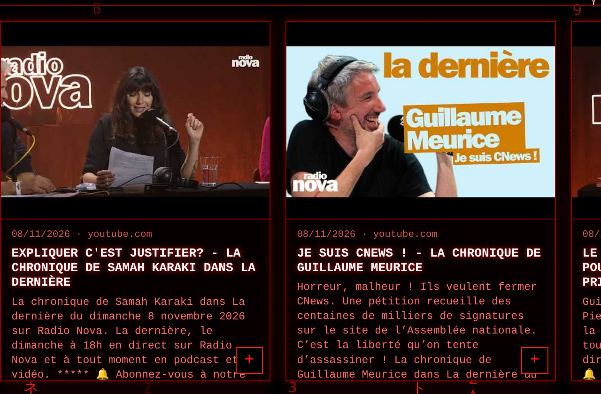

# gauchiasses.fr

Page « Mélenchon 2027 » (HTML5/CSS, sans JavaScript) et sa page de veille automatique.
Le dossier contient la page principale, les scripts qui génèrent la veille, et le
build qui construit les cartes Wikipédia à partir de fichiers texte.

## Aperçus

**Page principale** : le panneau avec la cagnotte, les 3 cartes, le lien vers la veille, le Discord et le code de conduite.

<p align="center"></p>

**Page de veille (`veille.html`)** : un panneau avec le titre et un nuage d'étiquettes, une par source. Cliquer sur une étiquette ouvre la liste des articles de cette source.

<p align="center"></p>

**Une section dépliée** (capture faite sur une copie de la page avec les sections ouvertes) : chaque carte affiche la miniature, la date, le titre et l'extrait.

<p align="center"></p>

## Sommaire

1. [Structure](#structure)
2. [Éléments immuables](#éléments-immuables)
3. [Veille automatique](#veille-automatique)
4. [Build des cartes](#build-des-cartes)
5. [Déploiement sur le serveur](#déploiement-sur-le-serveur)
6. [Limites et sécurité](#limites-et-sécurité)
7. [Licences](#licences)

## Structure

| Fichier / dossier | Rôle |
| --- | --- |
| `index.html` | Page principale. Modifiée à la main. Le bloc immuable n'est jamais touché par un build. |
| `favicon.svg` | Favicon du site, utilisée par `index.html` et `veille.html`. |
| `bin/build_site.py` | Construit la page de veille `veille.html`, à la racine. |
| `bin/publish_site.py` | Ancien envoi FTP (obsolète depuis le passage au serveur). |
| `RSS_feeds.txt` | Liste des flux RSS lue par `build_site.py` (copie de celle du bot Discord). |
| `Twich_feeds.txt` | Liste des chaînes Twitch lue par `build_site.py` (copie de celle du bot Discord). |
| `flux_perso.txt` | Réglages locaux de la veille : ignorer un flux, changer son nom affiché. |
| `veille.html` | Page de veille générée à la racine. Ne pas la modifier à la main. |
| `data/historique.db` | Base SQLite de tous les articles déjà récupérés. Jamais publiée. |
| `bin/garde_immuable.py` | Vérifie que le bloc immuable de `index.html` n'a pas changé. |
| `data/immuable.json` | Empreinte de référence du bloc immuable. |
| `deploy/installer_serveur.sh`, `deploy/installer_serveur.fish` | Installation sur le serveur : venv, `public/`, timer systemd (toutes les 30 min). |
| `deploy/synchroniser.sh` | Copie le projet du PC vers le serveur (rsync, sans l'historique ni le venv). |
| `deploy/deployer_nginx.sh` | Configure nginx pour `gauchiasses.fr` sur le serveur, avec le certificat Let's Encrypt. |
| `deploy/nginx-gauchiasses.conf` | Ancienne référence nginx, remplacée par `deployer_nginx.sh`. |
| `bin/publier_public.py` | Construit la veille, vérifie le bloc immuable, copie le site dans `public/`. |
| `deploy/installer_systemd.sh`, `deploy/installer_systemd.fish` | Ancienne installation FTP depuis le PC (obsolète). |
| `bin/gauchiasses-veille.service`, `bin/gauchiasses-veille.timer` | Modèles des unités systemd (lancent `publier_public.py` toutes les 30 min). |
| `bin/requirements.txt` | Dépendances Python de la veille. |
| `venv/` | Environnement Python, créé à l'installation (non versionné). |
| `old/` | Sauvegardes et anciens fichiers, non synchronisés (par ex. `index_849_cartes.html`, l'ancienne page complète). |
| `bin/construire_cartes.py` | Construit les cartes et le nuage de catégories dans `index.html`, à partir des fichiers texte. Tourne sur le PC. |
| `listes/` | Fichiers texte source des cartes (`Vipex.txt`, `On en veut pas !.txt`, `Plus jamais ça !.txt`). Lus par `construire_cartes.py`. |
| `data/cache/` | Caches du build des cartes et de la veille (aperçus, Twitch), rapport du dernier build. Non synchronisés. |
| `fonts/` | Police des titres (`russo-one.woff2`) et sa licence. Copiée dans `public/` à la publication. |
| `img/` | Images locales copiées par le build des cartes (si une liste en utilise). |
| `export/` | Copie locale de contrôle du projet (ce qui part sur le serveur). Non synchronisé. |

## Éléments immuables

Dans `index.html`, la zone entre `<!-- IMMUABLE:DEBUT -->` et `<!-- IMMUABLE:FIN -->` contient :
la cagnotte, les 3 cartes côte à côte, le lien vers la veille, le lien Discord et le code de conduite.

Aucun build ne doit modifier ce bloc.

```bash
python3 bin/garde_immuable.py verifier      # échoue si le bloc a changé
python3 bin/garde_immuable.py enregistrer   # accepte la version actuelle (après une modif voulue à la main)
```

Un build qui écrit `index.html` doit appeler `verifier_zone()` (dans `bin/garde_immuable.py`) avant et après son écriture.
Le build des cartes (`bin/construire_cartes.py`) écrit entre ses propres marqueurs, et vérifie ce bloc avant et après l'écriture.

## Veille automatique

Génère une page statique de veille (articles RSS et vidéos Twitch) avec titre, source, date,
extrait et aperçu, dans `veille.html`. Les articles sont regroupés par source dans des sections
repliables. La page ne contient aucun JavaScript et reprend le style de la page principale.

**Lisibilité** : les panneaux et les cartes sont opaques (pas de translucidité ni de flou). Les textes courants (titres d'articles, noms de sources, descriptions) n'ont pas de halo lumineux ; seuls les titres principaux et les étiquettes gardent leur effet. Ce réglage est dans le CSS de `bin/build_site.py` (veille) et dans `style_html` de `bin/construire_cartes.py` (page principale).

### Installation

Le dossier fournit `bin/requirements.txt` (`feedparser`, `yt-dlp`, `legacy-cgi`).
Créer un environnement virtuel et installer les dépendances :

```bash
python3 -m venv venv
venv/bin/pip install -r bin/requirements.txt
```

Les commandes ci-dessous utilisent `venv/bin/python`, à la racine du projet.
Le reste du dossier n'utilise que la bibliothèque standard.

### Construire la page

En local, le venv du projet est `venv_blog/` (`venv_blog/bin/python`). Sur le serveur, c'est `venv/`.

```bash
venv/bin/python bin/build_site.py                 # tous les articles de chaque flux RSS
venv/bin/python bin/build_site.py --no-twitch     # RSS seulement
venv/bin/python bin/build_site.py --no-previews   # sans visiter les pages (rapide)
venv/bin/python bin/build_site.py --no-cache      # ignorer les caches
venv/bin/python bin/build_site.py --nom veille.html
venv/bin/python bin/build_site.py -rss autres_flux.txt -tw autres_chaines.txt
```

- `-rss` : fichier des flux RSS. Par défaut `RSS_feeds.txt`.
- `-tw` : fichier des chaînes Twitch. Par défaut `Twich_feeds.txt`.
- `--nom` : nom du fichier HTML produit. Par défaut `veille.html`.

### Publier

```bash
venv/bin/python bin/publish_site.py              # construit puis envoie
venv/bin/python bin/publish_site.py --dry-run    # affiche ce qui serait envoyé
venv/bin/python bin/publish_site.py --no-build   # envoie le veille.html existant
```

Toujours faire un `--dry-run` avant le premier envoi vers un nouveau serveur.

Réglages en tête de `bin/publish_site.py` :
- `FTP_HOTE`, `FTP_PORT`, `FTP_UTILISATEUR`, `FTP_MOT_DE_PASSE` : connexion.
- `FTP_TLS` : `True` pour FTPS, recommandé si le serveur le propose.
- `FTP_MODE_PASSIF` : à garder à `True` dans la plupart des cas.
- `DOSSIER_DISTANT` : dossier du serveur où déposer la page. Valeur d'exemple à adapter.
- `NOM_PAGE` : nom du fichier HTML envoyé.
- `COMMANDE_BUILD` : arguments passés à `bin/build_site.py`.
- `EXCLUS` : fichiers jamais envoyés (les caches, qui sont dans `data/cache/`).

`veille.html` est envoyé à la racine de `DOSSIER_DISTANT`.
L'envoi ne supprime rien sur le serveur.

### Sources et réglages locaux

`flux_perso.txt` agit sur la veille seulement. Une ligne par réglage, avec une URL identique à
celle de `RSS_feeds.txt` :

```text
!"https://paris-luttes.info/spip.php?page=backend"                    # ignore le flux
"https://www.mediapart.fr/journal/podcasts/rss" | Mediapart (podcasts)  # renomme
```

Les listes `RSS_feeds.txt` et `Twich_feeds.txt` sont des copies. Si tu modifies celles du bot,
recopie-les ici.

### Historique (SQLite)

Chaque build enregistre les articles récupérés dans `historique.db` (table `articles`).
Rien n'est effacé automatiquement : un article déjà vu reste en base, et sa date de première
apparition est conservée (`premier_vu`).

La page n'affiche que les articles des sources **encore listées** (`RSS_feeds.txt`,
`Twich_feeds.txt`, sans les lignes ignorées dans `flux_perso.txt`). Retirer une ligne cache
donc ses articles sur le site, sans les effacer de la base : les remettre est une simple
réinsertion de la ligne.

Un flux injoignable au moment du build ne fait rien disparaître : ses articles déjà en base
restent affichés.

Pour repartir de zéro, supprimer `historique.db`.

### Caches

Dans `data/cache/` (non synchronisé) :
- `previews_cache.json` : titre, description et image des pages (Open Graph).
- `twitch_cache.json` : titre, date, durée et miniature des vidéos Twitch.

Un article ou une vidéo déjà connu n'est pas réinterrogé. Supprimer un cache, ou lancer avec
`--no-cache`, force une nouvelle récupération.

### Lien depuis la page principale

`index.html` contient un lien vers `veille.html` dans le bloc immuable. `veille.html` doit être publié
à côté de `index.html` : c'est le cas avec `publier_public.py`.

## Build des cartes

Le build construit les cartes et le nuage de catégories dans `index.html`, à partir de fichiers texte. Il tourne **sur le PC**, jamais sur le serveur. Le serveur ne reçoit que le résultat, avec le reste du projet.

### Fichiers utilisés

| Élément | Emplacement |
| --- | --- |
| Listes (fichiers texte) | `listes/*.txt` (aujourd'hui : `Vipex.txt`, `On en veut pas !.txt`, `Plus jamais ça !.txt`) |
| Anciennes listes | `~/zarisse.fr/listes/archive/` (hors du projet, non utilisées par le build) : les 13 listes précédentes |
| Script | `bin/construire_cartes.py` |
| Caches et rapport | `data/cache/` (`cache_wikipedia.json`, `cache_images.json`, `rapport_cartes.txt`) |
| Page modifiée | `index.html`, à la racine |
| Images locales | `img/`, à la racine |
| Police | `fonts/russo-one.woff2` |

### Format des fichiers texte

Le script accepte **deux formats**, mélangeables dans un même fichier. Les lignes qui commencent par `#` sont ignorées.

**1. Format copié-collé** : tu copies directement une catégorie depuis un autre outil. Le titre est suivi de `N cartes` (le nombre n'est pas utilisé), puis, pour chaque carte, le nom sur une ligne, la description sur la suivante, et une rareté facultative (`Commune`, `Rare`, `Inhabituelle`, `Épique`, `Exceptionnelle`, `Légendaire`, `Mythique`), ignorée à l'affichage. Les raretés sont ignorées partout où elles apparaissent. La liste est dans `RARETES` de `bin/construire_cartes.py` : à compléter si une nouvelle rareté apparaît :

```text
Vipex🚩
19 cartes
Marc Bloch
historien et résistant français
Mythique
Che Guevara
révolutionnaire marxiste et internationaliste argentin
Légendaire
```

Un emoji en fin de titre passe en tête à l'affichage : « Vipex🚩 » donne « 🚩Vipex », comme le format wikipick.

**2. Format wikipick** : un titre de catégorie seul sur sa ligne (un chiffre, le titre, puis le nombre entre parenthèses, le chiffre et le nombre ne sont pas affichés), et des cartes en gras. Les blocs sont séparés par une ligne vide. La ligne `image:` est facultative.

```text
5🚩Vipex (19)

**Marine Le Pen**
femme politique française
image: https://fr.wikipedia.org/wiki/Fichier:Exemple.jpg
```

Ici, la catégorie s'affiche « 🚩Vipex » (emoji au début).

Les lignes `image:` ne sont possibles que dans le format wikipick. Formes acceptées pour `image:` :

| Forme | Effet |
| --- | --- |
| `image: photos/nom.jpg` | Fichier local, relatif au fichier texte. Copié dans `img/`. |
| `image: Fichier:Nom.gif` ou `image: File:Nom.jpg` | Fichier Wikimédia : URL, auteur et licence récupérés. |
| `image: https://fr.wikipedia.org/wiki/Fichier:…` (ou `commons.wikimedia.org/wiki/File:…`) | Idem, à partir du lien de la page du fichier. |
| `image: https://…` | URL d'image directe, sans crédit automatique. |
| (absent) | Image principale de l'article Wikipédia, sinon l'initiale. |

Une ligne qui ne correspond à aucun des deux formats arrête le build avec son numéro : `format non reconnu`.

Le nom d'une carte doit correspondre à une page de fr.wikipedia.org. Les pages absentes et les pages d'homonymie sont exclues ; si une carte manque, vérifie son nom (ou utilise le titre exact de l'article) puis relance le build.

### Lancer le build

```bash
cd ~/gauchiasses.fr
python3 bin/construire_cartes.py listes/*.txt
```

Options :

| Option | Effet |
| --- | --- |
| `--hors-ligne` | N'interroge pas Wikipédia, utilise seulement les caches. |
| `--periode=SECONDES` | Période du passage au rouge des puces du nuage (défaut `5`). |
| `--police="Nom"` | Police des titres (défaut `Russo One`). Demande le fichier `fonts/<nom-en-minuscules-avec-tirets>.woff2`. |

Premier build, ou après une modification des versions de cache : environ 3 minutes (une requête par nom et par fichier image, avec une pause d'une seconde). Les builds suivants prennent quelques secondes. Si Wikipédia limite le débit (HTTP 429), le script attend et réessaie tout seul. Les caches sont sauvegardés à chaque lot : une interruption ne perd rien.

Le script écrit entre deux marqueurs, sans toucher au bloc immuable :
- `NUAGE-TAGS` (style et nuage des catégories), juste avant le bloc immuable ;
- `CARTES-TEXTE` (fenêtres de catégories et cartes), après le bloc immuable.

Le bloc immuable est vérifié avant et après l'écriture. Relancer le script remplace les blocs précédents.

Chaque carte a un bouton « + » qui ouvre une fiche avec l'extrait complet et toute la licence de l'image.

### Workflow avant synchronisation

1. Modifier les listes dans `listes/`.
2. Lancer le build (commande ci-dessus).
3. Lire `data/cache/rapport_cartes.txt` : pages absentes, homonymies, doublons.
4. Revérifier le bloc immuable : `python3 bin/garde_immuable.py verifier`.
5. Ouvrir `index.html` dans un navigateur : nuage, fenêtres, boutons « + », cartes du site, bouton « Qui sommes-nous ».
6. Régénérer l'export : `./deploy/synchroniser.sh ~/gauchiasses.fr/export/`.
7. Simuler puis synchroniser : `./deploy/synchroniser.sh --simuler`, puis `./deploy/synchroniser.sh`.
8. Publier : sur le serveur, `sudo systemctl start gauchiasses-veille.service` (ou attendre le timer, toutes les 30 minutes). Vérifier ensuite que `public/index.html` a la même somme de contrôle que `index.html`.

### Texte « Qui sommes-nous »

Le bouton et le panneau sont écrits à la main dans `index.html`, entre `QUI-SOMMES-NOUS:DEBUT` et `QUI-SOMMES-NOUS:FIN`. Le build ne touche pas à cette zone : modifie le texte directement là.

### Messages d'erreur fréquents

| Message | Solution |
| --- | --- |
| `bloc sans nom en gras ni titre de catégorie` | Ajouter le `**` au nom, ou vérifier la ligne vide avant le bloc. |
| `image introuvable : …` | Corriger le chemin, relatif au fichier texte. |
| `URL refusée (http, pas https)` | Utiliser `https://`. |
| `HTTP 429` | Rien à faire : le script attend et réessaie. Sinon, relancer plus tard. |
| `absent(s) du cache, refusés (--hors-ligne)` | Relancer sans `--hors-ligne`, avec une connexion. |
| `le bloc immuable a été modifié` | Ne pas modifier le bloc immuable à la main. Le restaurer depuis une copie. |
| `section « cartes » introuvable` | Vérifier que `index.html` est bien la page principale. |

### Réglages

- Dans le bloc CSS généré (entre `NUAGE-TAGS`), les variables `:root` contrôlent les couleurs, les tailles des puces, des fenêtres et des cartes. Elles sont réécrites à chaque build : pour les garder, modifie la fonction `style_html` dans `bin/construire_cartes.py`.
- Dans `bin/construire_cartes.py` : `VERSION_CACHE` et `VERSION_FICHIERS` forcent une nouvelle récupération quand on les incrémente ; `TAILLE_LOT` et `PAUSE` règlent le rythme des requêtes.

## Ancienne publication FTP (obsolète)

Les sections « Publier » et « Publication automatique » décrivent l'ancien mode : construction sur le PC, envoi en FTP. Le site est maintenant servi par le serveur, voir [Déploiement sur le serveur](#déploiement-sur-le-serveur).

### Ancien installateur systemd (FTP)

Sur la machine de destination, dans le dossier du projet :

```bash
./deploy/installer_systemd.sh                 # installe et active le timer (sudo demandé)
./deploy/installer_systemd.sh --desinstaller  # arrête et supprime le service et le timer
# En fish, le même script existe : ./deploy/installer_systemd.fish (mêmes options)
```

Le script installe `python3` et `python3-venv` si besoin, crée `venv/` et y installe
`bin/requirements.txt`, restreint `bin/publish_site.py` au propriétaire (`chmod 600`, il contient le mot
de passe FTP), puis installe `gauchiasses-veille.service` et `gauchiasses-veille.timer` dans
`/etc/systemd/system`. Le timer lance la publication 2 minutes après le démarrage, puis toutes les
30 minutes.

Suivi :

```bash
systemctl list-timers gauchiasses-veille.timer
journalctl -u gauchiasses-veille.service -n 50
sudo systemctl start gauchiasses-veille.service   # lancer une publication tout de suite
```

## Déploiement sur le serveur

Le site est construit et servi par le serveur perso (Debian 13, nginx). Le projet vit dans
`/home/meli/gauchiasses.fr`, et la racine servie est `public/`.

### Depuis ton PC : copier le projet

```bash
./deploy/synchroniser.sh --simuler   # vérifie ce qui serait copié
./deploy/synchroniser.sh             # copie vers meli@192.168.1.13:/home/meli/gauchiasses.fr/
```

Ne sont pas copiés : `venv/`, `venv_blog/`, `data/historique.db`, `data/cache/`, `public/`, `old/`, `export/`, `.git/`.
`data/immuable.json` est copié (le serveur en a besoin pour publier la page principale).
Pas de `--delete` : un fichier supprimé sur le PC reste sur le serveur tant qu'on ne le retire pas à la main.

### Sur le serveur : installer

```bash
cd /home/meli/gauchiasses.fr
./deploy/installer_serveur.sh          # ou ./deploy/installer_serveur.fish
./deploy/installer_serveur.sh --desinstaller
```

L'installation crée le venv, prépare `public/` et `data/`, installe le timer systemd et lance
une première publication. Chaque passage (toutes les 30 min) :
1. reconstruit la veille à partir des flux, et ajoute les nouveaux articles à `data/historique.db` ;
2. vérifie le bloc immuable de `index.html` ;
3. copie `index.html`, `favicon.svg` et `veille.html` dans `public/`.

Si le bloc immuable a été modifié, la page principale n'est pas publiée et le journal l'indique.

### Suivi

```bash
systemctl list-timers gauchiasses-veille.timer
journalctl -u gauchiasses-veille.service -n 50
sudo systemctl start gauchiasses-veille.service   # publier tout de suite
```

### Vérifier la mise en ligne

Sur le serveur, `./deploy/verifier_serveur.sh` contrôle le DNS, nginx, les pages en HTTPS, le certificat et son
renouvellement, les timers et la date de la dernière publication. Il affiche ce qui reste à vérifier à la main.
Avec `--externe`, il teste aussi l'accès via l'IP publique (à lancer depuis l'extérieur de ton réseau).

### nginx et DNS

Sur le serveur, nginx est configuré par `deploy/deployer_nginx.sh` :

```bash
./deploy/deployer_nginx.sh --email toi@exemple.fr   # HTTP puis HTTPS (Let's Encrypt)
./deploy/deployer_nginx.sh --sans-certificat        # HTTP seulement
./deploy/deployer_nginx.sh --desinstaller           # retire le site (certificats conservés)
```

Le certificat couvre `gauchiasses.fr` seul : `www.gauchiasses.fr` n'a pas d'enregistrement DNS. Pour l'ajouter, crée d'abord le DNS, puis adapte le script.

Le script écrit `/etc/nginx/sites-available/gauchiasses.fr`, teste la configuration, et la remet
en place si elle est invalide. Il ne touche pas aux autres sites (ex. `blog.zarisse.fr`).

Étapes : HTTP seul d'abord, puis certificat, puis HTTPS. Le certificat n'est demandé que si
`gauchiasses.fr` pointe vers l'adresse du serveur. Sinon le site reste en HTTP, et il suffit de
relancer le script une fois le DNS mis à jour.

Prérequis : nginx doit pouvoir lire `public/`. Si le script le signale, il faut autoriser la
traversée du dossier home (`chmod o+x /home/meli`). Ce changement est à valider par toi.

`deploy/nginx-gauchiasses.conf` est une référence de l'ancienne version, remplacée par le script.

## Mise en ligne (ancienne méthode FTP)

Envoyer en FTP :
- `index.html` et `favicon.svg` ;
- `veille.html` si la veille est utilisée.

Ne pas envoyer : `bin/`, `data/`, `deploy/`, `old/`, les fichiers de flux et `flux_perso.txt`.

## Limites et sécurité

- **Mot de passe FTP en clair** dans `bin/publish_site.py`. Ne publie pas ce fichier avec le vrai mot
  de passe. Préfère FTPS quand c'est possible.
- **Réseau local** : Chrome demande l'accès au réseau local si la page charge une ressource
  dont le nom se résout en adresse privée. Par exemple, `blog.zarisse.fr` se résout en
  `192.168.1.13` sur la machine de développement. Ne mets pas de flux ou d'image de ce type
  dans la veille.
- Un flux injoignable est ignoré avec un message `[flux] …` ; la page est construite sans lui.
- Twitch passe par yt-dlp. Une chaîne sans vidéo accessible ne produit aucune carte.
- Les aperçus viennent de la page de l'article ; certains sites ne fournissent pas d'image.

## Licences

Textes : Wikipédia, CC BY-SA 4.0. Images : Wikimedia Commons ou Wikipédia, auteur et licence
indiqués sur la page du fichier, liée depuis chaque fiche. Articles de veille : leurs auteurs
et sites respectifs.
